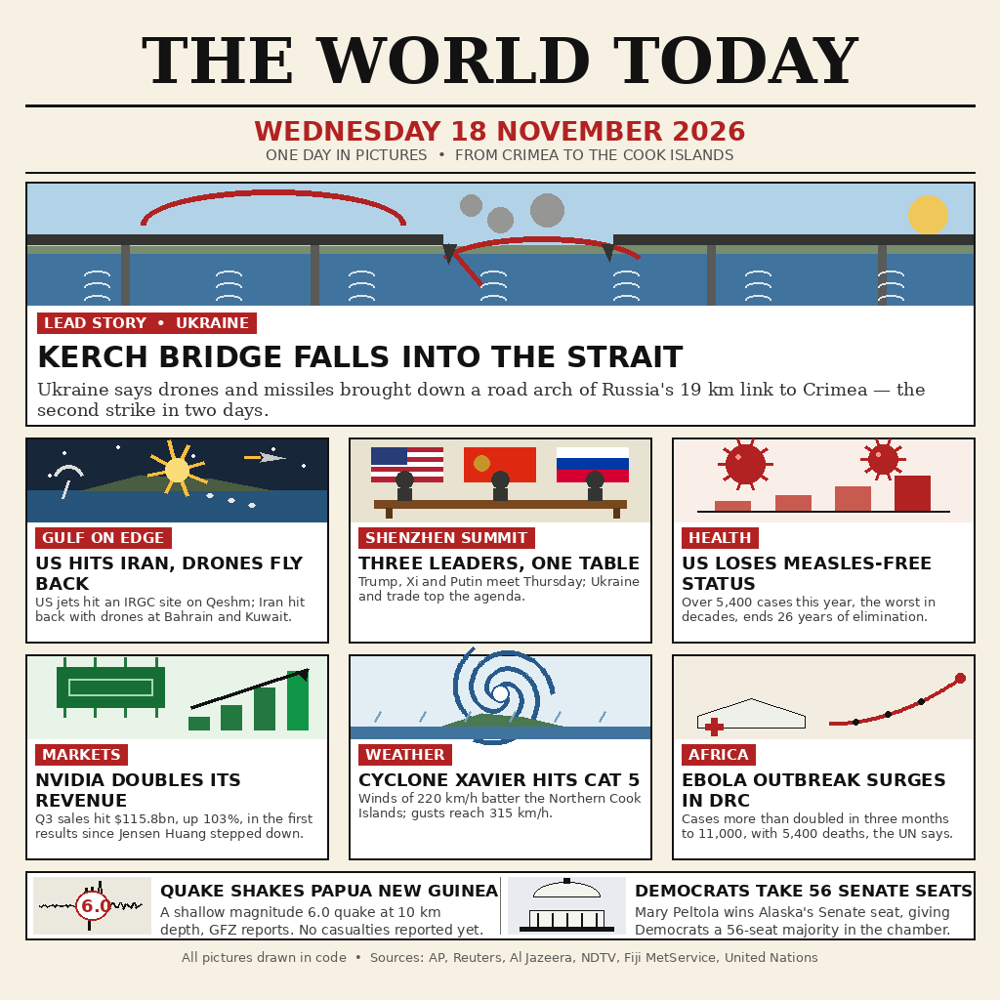

# The World Today — Wednesday 18 November 2026

A newspaper front page that sums up 18 November 2026 in a single image,
drawn entirely in code with Pillow. No photographs, no external images,
no network access at run time.

Built for the make.fun competition
[`news-image-20261118`](https://make.fun/competitions/news-image-20261118)
— "Sum up 18 November's world news in one image".



## How it works

- `make_image.py` draws the whole front page: masthead, dateline, lead
  story, six picture stories and a bottom strip, using only Pillow
  shapes (rectangles, ellipses, polygons, arcs and lines) and the
  DejaVu fonts shipped with the system.
- `main.py` is the competition entry point: it writes the finished
  page to `/output/entry.png`.
- The build is fully deterministic — run `main.py` twice and the two
  files are byte-identical (same SHA-256).

```sh
python3 main.py        # writes /output/entry.png
python3 make_image.py  # writes ./entry.png
```

## Stories covered

| Story | What the picture shows |
|---|---|
| Kerch Bridge falls (lead) | A road arch of Russia's 19 km link to Crimea collapses into the strait after a second day of Ukrainian drone and missile strikes. |
| Gulf on edge | US jets hit an IRGC missile site on Qeshm Island; Iran answers with drones at Bahrain and Kuwait. |
| Shenzhen summit | Trump, Xi and Putin meet on Thursday, with Ukraine and trade at the top of the agenda. |
| US loses measles-free status | Over 5,400 cases this year, the worst outbreak in decades, ends 26 years of elimination. |
| Nvidia doubles its revenue | Q3 sales of $115.8bn, up 103%, in the first results since Jensen Huang stepped down. |
| Cyclone Xavier hits Cat 5 | Winds of 220 km/h batter the Northern Cook Islands, with gusts to 315 km/h. |
| Ebola outbreak surges in DRC | Cases more than doubled in three months to 11,000, with 5,400 deaths. |
| Quake shakes Papua New Guinea | A shallow magnitude 6.0 earthquake at 10 km depth. |
| Democrats take 56 Senate seats | Mary Peltola wins Alaska's Senate seat. |

Sources: AP, Reuters, Al Jazeera, NDTV, Fiji MetService, United Nations.

## Licence

MIT — see [LICENSE](LICENSE).
